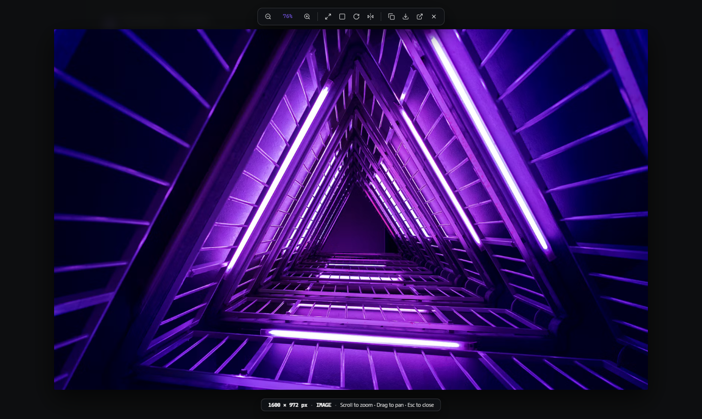
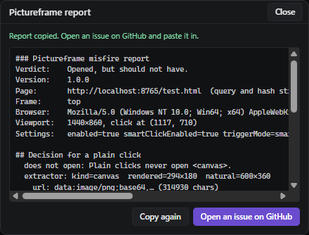

  <picture>
    <source media="(prefers-color-scheme: dark)" srcset="docs/images/banner.png">
    <source media="(prefers-color-scheme: light)" srcset="docs/images/banner-paper.png">
    
  </picture>

  A browser extension to <b>inspect, pan and cursor-zoom any picture</b> on the web.
   
  Manifest V3 · Chrome, Edge and Brave · Nothing leaves your browser

> Pictureframe is young and not on the Chrome Web Store yet. It works on the sites it has been tried on; see [What is not there yet](#what-is-not-there-yet), and [report a misfire](#reporting-a-misfire) when it gets a page wrong.

## Install

| Browser | How |
| :--- | :--- |
| Chrome, Edge, Brave | Clone or download this repository, open `chrome://extensions`, turn on **Developer mode**, choose **Load unpacked** and pick the folder. |

Any Chromium browser that supports Manifest V3 should work. Pin the extension to the toolbar to reach its settings.

## Click a picture, it opens

Click a plain image and it opens in a fullscreen viewer. If the image is a link, a button or part of a site's own gallery, Pictureframe leaves the click to the page. Hold <kbd>Alt</kbd> while clicking, or use the small button in the image's corner, to open it anyway.

## Zoom where you point

The scroll wheel zooms around the pixel under the cursor, from 5 % to 5000 %, and dragging pans. Past 4× the picture switches to sharp pixels so you can inspect detail. Rotate, flip, copy to the clipboard or download from the toolbar.

## Right click, unblocked

Sites that disable right click, or lay a transparent sheet over their photos, get their own image menu back. The picture under the sheet is found and opened, not the sheet.

## Reporting a misfire

If Pictureframe opens something it should not, or ignores a picture it should open, choose **Opened wrongly** or **Did not open** in the toolbar popup and click the element. The page never sees that click. Pictureframe copies a report of what it saw and why it decided as it did; paste it into a [new issue](https://github.com/Spillebulle/Pictureframe/issues/new).

 

## What is not there yet

- **Not on the Chrome Web Store.** Install it unpacked for now.
- **Canvases, inline SVG and videos open only on purpose.** Spreadsheets, charts and maps draw on these, so a plain click never opens them; use <kbd>Alt</kbd> + click or the corner button.
- **The right click unblocker is blunt.** It can replace a site's own right click menu (Google Sheets, for example) with the browser's. Turn it off in the popup on those sites.
- **Firefox is untested.**

## Controls

| Action | Key or gesture |
| :--- | :--- |
| Zoom at the cursor | Scroll wheel |
| Pan | Drag, or arrow keys |
| Zoom in / out | `+` / `-` |
| Fit to window | `F` or `0` |
| Actual size | `1` |
| Rotate 90° clockwise | `R` |
| Flip horizontally | `H` |
| Copy image | `C` |
| Download image | `D` |
| Close | `Esc`, or click the backdrop |

## Building from source

There is no build step. The folder is the extension: load it unpacked as above, and after editing a file press the reload arrow on the extension card and reload the page you are testing. Open `test.html` to check plain images, linked images, a blocked right click, a transparent shield and a canvas on one page.

## Licence

GPL-3.0, see [LICENSE](LICENSE). Includes Archivo (SIL Open Font License, `fonts/OFL.txt`) and icon geometry from Lucide (ISC).
